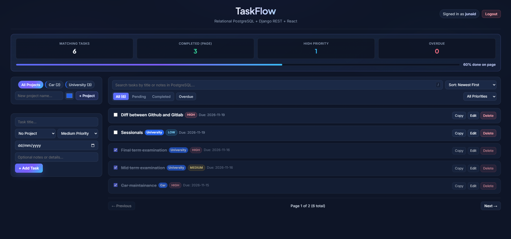

# TaskFlow — Full-Stack Project & Task Manager



A multi-user project and task tracking web application built with **React (Vite)**, **Django REST Framework**, and **PostgreSQL**. Features cryptographic token authentication, private user workspaces, color-coded relational projects, server-side search/sorting, and paginated API responses.

## Tech Stack

- **Frontend:** React 19, Vite, Modular Component Architecture, Custom CSS
- **Backend:** Python, Django, Django REST Framework (`ModelViewSet`, `DefaultRouter`, Token Auth)
- **Database:** PostgreSQL (`User` -> `Project` -> `Task` relational schema with `select_related` query optimization)

## Key Features

- **Token Authentication & Private Workspaces:** User registration and login endpoints issuing unique tokens; all database queries are scoped strictly to the authenticated user.
- **Relational Project Categorization:** Color-coded `Project` entities linked to `Task` records via Foreign Keys with live task counters.
- **Server-Side Search, Filtering & Pagination:** PostgreSQL-backed search across titles and descriptions, multi-criteria filtering (status, priority, project), dynamic ordering, and paginated results.
- **Inline Task Management:** Create, toggle completion, filter, and inline-edit task titles, notes, due dates, priorities, and project assignments.

## API Endpoints

| Method | Endpoint | Auth Required | Description |
| :--- | :--- | :---: | :--- |
| `POST` | `/api/register/` | No | Register a new user and return an auth token |
| `POST` | `/api/login/` | No | Authenticate credentials and return an auth token |
| `GET` | `/api/projects/` | Yes | List all projects owned by the current user |
| `POST` | `/api/projects/` | Yes | Create a new color-coded project |
| `GET` | `/api/tasks/` | Yes | Paginated task list (`?search=`, `?project=`, `?priority=`, `?completed=`, `?ordering=`) |
| `POST` | `/api/tasks/` | Yes | Create a new task linked to the current user |
| `PATCH` | `/api/tasks/<id>/` | Yes | Update task fields or toggle completion status |
| `DELETE` | `/api/tasks/<id>/` | Yes | Delete a task |

## Local Setup

### 1. Backend Setup
```bash
